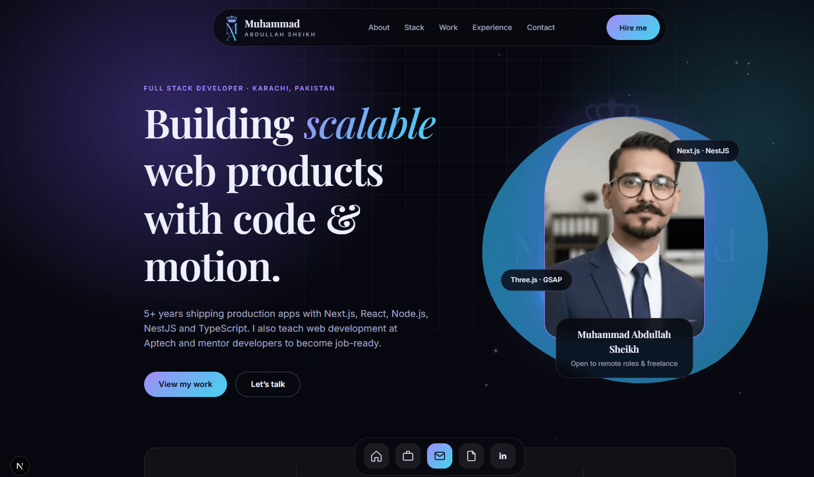

# 🚀 Muhammad Abdullah — Developer Portfolio

A modern, responsive, and animated developer portfolio built with **Next.js**, **TypeScript**, **Tailwind CSS v4**, **GSAP**, **Lenis**, **Motion**, and **React Three Fiber**.



---

## ✨ Features

- Modern & Responsive Design
- Smooth GSAP Animations
- Interactive 3D Hero Section
- Dark Theme UI
- SEO Optimized
- Fast Performance
- Contact Form Integration
- Mobile Friendly

---

## 🛠 Tech Stack

- Next.js (App Router)
- TypeScript
- Tailwind CSS v4
- GSAP
- Lenis
- Motion
- React Three Fiber

---

## 📦 Getting Started

Clone the repository

```bash
git clone https://github.com/yourusername/portfolio.git
```

Install dependencies

```bash
npm install
```

Run the development server

```bash
npm run dev
```

Open your browser and visit:

```
http://localhost:3000
```

---

## 📁 Project Structure

```text
src/
├── app/
├── components/
├── lib/
└── styles/

public/
```

---

## 📸 Preview

Replace `public/preview.png` with a screenshot of your portfolio homepage.

---

## ⭐ Show Your Support

If you like this project, consider giving it a ⭐ on GitHub.

---

## 📄 License

This project is licensed under the MIT License.